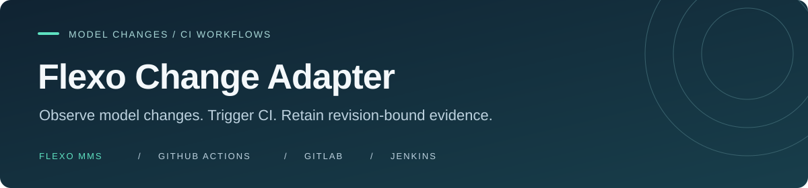

<p align="center">
  
</p>

<h1 align="center">Flexo Change Adapter</h1>

<p align="center">
  Connect Flexo model changes to your CI workflows.<br />
  A small, self-hosted adapter with durable state and validation tied to the exact observed revision.
</p>

<p align="center">
  <a href="LICENSE"></a>
  <a href="package.json"></a>
  <a href="src-ts/"></a>
  <a href="docs/configuration.md"></a>
</p>

<p align="center">
  <a href="#quick-start">Quick start</a> ·
  <a href="#features">Features</a> ·
  <a href="#integrations">Integrations</a> ·
  <a href="#documentation">Documentation</a> ·
  <a href="CONTRIBUTING.md">Contributing</a> ·
  <a href="SECURITY.md">Security</a>
</p>

---

Flexo Change Adapter watches a Flexo MMS repository branch, records observed revisions in SQLite, and routes work to configured CI destinations. Use it to publish an activity feed, validate an immutable model snapshot with SHACL through GitHub Actions, or trigger a GitLab pipeline or Jenkins job with exact revision metadata.

**GitHub Actions is the first validation target; the core remains CI-agnostic.**

## Features

- **Observe model changes.** Poll a selected Flexo branch and retain a baseline and subsequent head changes.
- **Keep work through restarts.** Commit events, action intents and checkpoints together in SQLite. Queued actions retain their original destinations and validation identities after configuration changes.
- **Validate the observed revision.** Bind GitHub validation to a verified snapshot, pinned SHACL rule and validator identity, even when the branch moves.
- **Publish an activity feed.** Write an optional versioned JSON feed for a frontend or read-only API, with or without CI actions.
- **Configure independent actions.** Select built-in sources, tasks and destinations with one versioned JSON file. Check it offline before contacting a service.
- **Retain useful evidence.** Distinguish SHACL violations from execution errors and retain revision, rule, result and report identities.

Polling captures the latest observed head; intermediate commits between polls may be skipped. Native webhooks, brokers and dynamically loaded plugins are outside the implementation.

## Integrations

| Integration    | Capability                                                     | Setup                                                      |
| -------------- | -------------------------------------------------------------- | ---------------------------------------------------------- |
| Flexo MMS      | Poll one repository branch and retrieve commit-pinned inputs   | Existing HTTPS endpoint and authorized source credentials  |
| GitHub Actions | Validate pinned snapshots with SHACL and retain claims/results | Private execution repository with matching reviewed worker |
| GitLab CI/CD   | Trigger pipelines and reconcile native outcomes                | Reviewed pipeline, trigger and read credentials            |
| Jenkins        | Trigger parameterized jobs and reconcile native outcomes       | Reviewed job and API token; local test setup included      |
| JSON feed      | Publish retained baseline/change events                        | Optional writable feed path; no CI required                |

This is an initial alpha release. The [project status](docs/status.md) describes implementation and verification limits. GitHub validation requires matching reviewed watcher/worker source in a private execution repository; the source repository can be public.

Generic GitLab/Jenkins success does not establish SHACL conformance. Model SHACL validation is also distinct from SysML implementation testing and human research-case validation.

## Modularity and configuration

One versioned JSON file selects **what to track**, **where to retain state and publish a feed**, and **what to trigger**. Each action selects event kinds with `on`, work with `task`, and a destination with `target`.

The implementation separates these responsibilities:

| Module                                                         | Responsibility                                                                                                                     |
| -------------------------------------------------------------- | ---------------------------------------------------------------------------------------------------------------------------------- |
| [Configuration and registry](src-ts/configuration.ts)          | Validate settings offline and select explicitly registered source/task/target types; configuration cannot load executable plugins. |
| [Source](src-ts/sources.ts) and [observer](src-ts/observer.ts) | Read the selected Flexo branch and detect baseline/change events independently of downstream CI.                                   |
| [Journal](src-ts/journal.ts) and [feed](src-ts/feed.ts)        | Atomically retain events, action intents and checkpoint in SQLite, then publish the optional JSON feed.                            |
| [Actions](src-ts/actions.ts) and [runtime](src-ts/runtime.ts)  | Route tasks to GitHub validation or GitLab/Jenkins triggers and advance destinations independently of polling.                     |

Built-in adapters use ordinary TypeScript modules with explicit registration and load only when selected. Feed-only and generic CI operation do not load the GitHub validation adapter or SHACL engine. Adding a source, storage engine or CI platform requires code; configuration selects the supported implementations. New events use changed settings after restart, while queued actions retain their original bindings. See [architecture](docs/architecture.md) and [configuration](docs/configuration.md).

## Quick start

Use **Node.js 24.16.0** and npm. The runtime uses Node's experimental SQLite support. Configured `run` commands, including `--once`, require Linux `flock`.

### 1. Install and inspect

From the repository root:

```bash
npm ci
npm run adapter -- --help
npm run adapter -- check --config examples/configuration/feed.json
```

The example check runs offline, needs no credentials and creates no state. Use the committed `package-lock.json` for reproducible installs.

### 2. Configure a source

Create `.local/adapter.json` with the following content, replacing the placeholder endpoint and resource names with your existing Flexo source:

```json
{
  "schema_version": 1,
  "id": "satellite",
  "state_directory": "./satellite",
  "source": {
    "type": "flexo",
    "endpoint": "https://flexo.example",
    "organization": "research",
    "repository": "satellite",
    "branch": "main"
  },
  "observation": { "mode": "poll", "interval_seconds": 30 },
  "feed": { "type": "json-feed", "path": "./satellite/output/activity.json" },
  "actions": []
}
```

Paths resolve relative to the JSON file. This configuration stores state and the feed under `.local/satellite/`; SQLite defaults to `STATE_DIRECTORY/events.sqlite`; set `database` to choose another location. The feed is optional. Keep state on persistent storage and use separate state/output paths for each source.

For CI actions, start with [GitHub validation](examples/configuration/github-validation.json) or [GitLab/Jenkins triggers](examples/configuration/gitlab-jenkins.json). Select `branch-change` for later changes; include `baseline` explicitly to trigger on first observation. The example SHACL rule targets its demonstration model and must be replaced for other models.

### 3. Observe and inspect

Load approved credentials into the process environment, then run:

```bash
npm run adapter -- check --config .local/adapter.json
npm run adapter -- run --config .local/adapter.json --once
npm run adapter -- status --config .local/adapter.json

# Keep polling and advancing configured actions:
npm run adapter -- run --config .local/adapter.json
```

`run --once` performs one observation and delivery round. Repeat it or run continuously to collect CI results. `status` inspects retained state without remote access.

Keep secrets out of JSON and command arguments. Flexo reads use `FLEXO_TOKEN`, or `FLEXO_PASSWORD` with `FLEXO_USERNAME` (default `rohan`); GitHub uses `GITHUB_TOKEN`. Other credential names and platform requirements are covered in the [configuration guide](docs/configuration.md). Use approved 1Password references and environment helpers; leave direnv trust approval to the owner.

## Run with Docker

Prepare a directory containing `adapter.json` and any rules. Set the container configuration's `state_directory` to `/data`, the optional feed path to `/data/output/activity.json`, and rule paths relative to `/configuration`.

```bash
# Point ADAPTER_CONFIG_DIR at that prepared directory; load credentials separately.
ADAPTER_CONFIG_DIR=/path/to/configuration docker compose -f compose.configured.yaml config --quiet
ADAPTER_CONFIG_DIR=/path/to/configuration docker compose -f compose.configured.yaml build adapter
ADAPTER_CONFIG_DIR=/path/to/configuration docker compose -f compose.configured.yaml run --rm --no-deps adapter check --config /configuration/adapter.json
ADAPTER_CONFIG_DIR=/path/to/configuration docker compose -f compose.configured.yaml run --rm --no-deps adapter run --config /configuration/adapter.json
```

Configuration mounts read-only; `/data` is a persistent volume. Mounted files must be readable by the non-root container user. See [configured Docker operation](docs/configuration.md#docker) for credential pass-through and [installation](docs/installation.md) for native, `just` and Docker workflows.

## Local Jenkins test service

A dedicated local Jenkins job can exercise CI triggering without a hosted account:

```bash
just jenkins-local-up
just jenkins-local-status
just jenkins-local-test
# Stop it when finished; build history is retained:
just jenkins-local-down
```

Open <https://localhost:18443/job/adapter-smoke/> to inspect builds. This localhost-only service uses a self-signed certificate and a generated API token held in runtime memory. The helper loads the token automatically; there is no secret value to paste into JSON. See [local Jenkins setup and verification](docs/local-jenkins.md) for configuration, certificate handling and lifecycle details.

## Development

```bash
npm run check
npm test
npm run format:check
```

The TypeScript suite covers persistence, transaction rollback, moving revisions, lock retargeting, SHACL failures, lost responses, competing worker claims and configuration recovery. Platform transport tests are separate from live acceptance evidence.

Adapters are explicitly registered TypeScript modules. Read the [architecture](docs/architecture.md) and [configuration](docs/configuration.md) before changing dispatch, revision retrieval or recovery. Keep changes focused and request approval before adding production dependencies.

## Documentation

| Guide                                               | What you will find                                                             |
| --------------------------------------------------- | ------------------------------------------------------------------------------ |
| [Project status](docs/status.md)                    | Current capabilities, evidence and deployment limits                           |
| [Architecture](docs/architecture.md)                | Current components, data flow and recovery boundaries                          |
| [Examples](examples/README.md)                      | Feed-only, GitHub validation and generic CI starting points                    |
| [Troubleshooting](docs/troubleshooting.md)          | Diagnostics for configuration, authentication, state and CI delivery           |
| [Installation](docs/installation.md)                | Native setup, `just` recipes, containers and persistent storage                |
| [Configuration and recovery](docs/configuration.md) | JSON contract, credentials, actions, retained identities and backups           |
| [Activity feed](docs/event-feed.md)                 | Feed-only JSON operation and activity schema                                   |
| [GitHub execution](docs/github-execution.md)        | Workflow permissions, snapshot delivery, worker claims, retry and crash limits |
| [Releasing](docs/releasing.md)                      | Versioning and prerelease procedure                                            |

Operation uses `check`, `run` and `status` with `--config`. Utilities are `prepare-request`, `snapshot`, `validate` and `validator-identity`; run each with `--help`. Standalone `validate` exits 0 for conformance, 1 for nonconformance and 2 for handled errors.

## Operational boundaries

- Match the watcher and reviewed GitHub workflow's source, locked dependencies and Node runtime. These form the validator identity; queued work retains its original identity.
- Review [recovery and retention limits](docs/github-execution.md) before operating a watcher. Worker-crash re-execution is deliberately disabled; ambiguous generic CI submissions are never automatically resent.
- Use an existing commit-pinned Flexo lock unless lock creation has been explicitly authorized. The configured GitHub action also requires `allow_lock_creation: true` to create one.
- A hosted runner does not automatically reach private Tailscale services. The GitHub worker receives verified snapshots instead of infrastructure credentials.
- Production credentials, deployment, backup, tag protection and retention policy require deliberate setup. Packaging does not provision or deploy a service.

## Contributing

See the [contribution guide](CONTRIBUTING.md) for development setup, checks and pull request guidance, and the [changelog](CHANGELOG.md) for release changes. For bugs and feature requests, use the [project repository](https://github.com/Open-MBEE/flexo-change-adapter).

Maintained by [rororowyourboat](https://github.com/rororowyourboat), with contributors from [Dynamical Systems Group](https://www.dynamicalsystemsgroup.com/). Part of the OpenMBEE ecosystem. Passing model SHACL validation is distinct from SysML implementation conformance and human research-case acceptance.

## Security

Report suspected vulnerabilities privately to [rohan@dynamicalsystemsgroup.com](mailto:rohan@dynamicalsystemsgroup.com). See the [security policy](SECURITY.md) for reporting guidance and data boundaries.

## License

Released under the [Apache License, Version 2.0](LICENSE). Bundled third-party assets retain their [notices](src-ts/assets/NOTICE.md).
