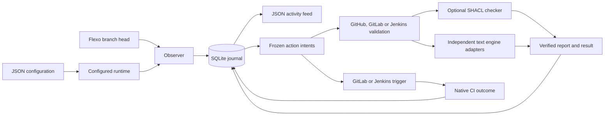

# Architecture

The adapter polls one Flexo branch per process, durably records observed revisions, and advances independently configured actions. TypeScript runs directly on Node 24.16.0. See [configuration](configuration.md) for the public contract and [project status](status.md) for recorded verification limits.

## Responsibilities

| Boundary                     | Code                                                                                     | Responsibility                                                                                                     |
| ---------------------------- | ---------------------------------------------------------------------------------------- | ------------------------------------------------------------------------------------------------------------------ |
| Configuration and entrypoint | `configuration.ts`, `cli.ts`                                                             | Validate schema, supported pairings and paths; expose offline `check`, configured `run` and retained `status`.     |
| Source and observation       | `sources.ts`, `flexo.ts`, `observer.ts`                                                  | Read the exact observed branch head; record baseline/change or failed-read health.                                 |
| Durable journal              | `journal.ts`, `ownership.ts`, `locking.ts`                                               | Bind state to a source, retain events and frozen action intents transactionally, and prevent competing ownership.  |
| Feed projection              | `feed.ts`                                                                                | Atomically publish a read-only JSON view that can be regenerated from the journal.                                 |
| Runtime and registry         | `runtime.ts`, `actions.ts`                                                               | Run observation independently from bounded delivery groups; select explicitly registered task/target combinations. |
| Validation lifecycle         | `github-action.ts`, `engine-action.ts`, `service.ts`, `state.ts`, `validation-runner.ts` | Prepare pinned snapshots/rules, retain computation identity, dispatch and reconcile claims/results.                |
| Generic CI                   | `ci-trigger.ts`                                                                          | Submit source metadata to GitLab/Jenkins and reconcile native job states.                                          |

Code paths in this table are relative to `src-ts/`. The registry supports both `shacl-validation` and `engine-validation` on `github`, `gitlab` and `jenkins`, plus `ci-trigger` on `gitlab` and `jenkins`; it does not load executable plugins from configuration. Adapter modules are imported only when selected by current configuration or a retained intent. Retained work still selects its original adapter after configuration removal. SHACL/SPARQL loads inside validation; RDF canonicalization loads only for graph comparison. Offline `check` and help do not load RDF parsing. JSON is the single operating configuration.

Text engines use a shared `EngineRequest` and native-evidence result contract. `engine-contracts.ts` pins reviewed profiles; `model-input.ts` captures and verifies original text from producer manifests; `engine-execution.ts` owns bounded process/container execution and native report decoding. `engine-action.ts` connects those modules to durable intents, and `engine-record.ts` binds checker data records to the shared claim/reconciliation protocol. SHACL retains its RDF/rule contract and uses the same delivery lifecycle. See [engine implementation](validation-engines.md).

## Persistence and identity

A successful new observation commits its event, selected action intents, retained rule bytes and checkpoint atomically. A failed source read does not advance the checkpoint. Returning from revision A to B to A creates two change events. Event identity, destination-specific delivery identity and reusable validation computation identity remain separate.

Queued actions retain their original destination, task settings and credential variable names. Rule bytes and validator identity are pinned for validation work. Configuration changes cannot silently retarget pending work. Resolved credentials are supplied through the environment rather than persisted in action records.

The optional feed is a projection: failure to publish it leaves observations durable and allows later recovery. SQLite and prepared input spools need persistent storage. The adapter initializes its own schema and refuses unsupported databases. See [state and backups](configuration.md#state-and-backups).

## Execution and recovery

GitHub receives verified immutable model/rule bundles in a private repository. A durable create-only worker claim prevents a competing job from repeating checker execution for that work identity. Completion requires matching retained input, report, result and workflow-attempt evidence. See [GitHub execution and recovery](github-execution.md).

GitLab/Jenkins validation uses `shared-validation.ts`, `native-ci.ts` and `file-evidence.ts` to publish the same verified checker records in a shared durable POSIX directory. Create-only claims bind execution to an exact native job/build. Reconciliation checks both the retained native report and platform identity/status. `validation-records.ts` shares checker invocation and evidence verification across all three runners. See [native validation](gitlab-jenkins-validation.md).

Generic GitLab/Jenkins `ci-trigger` actions receive revision metadata and retain native outcomes. Ambiguous generic submissions are reconciled without automatic resubmission; unresolved cases stay visible for operator investigation.

The process samples the latest head and can miss intermediate commits. It has no native Flexo listener, broker, production deployment manager or general exactly-once guarantee. A claimed validation worker that crashes without a result requires an operator decision. Polling and delivery use bounded network operations; shutdown can wait for in-flight requests.
