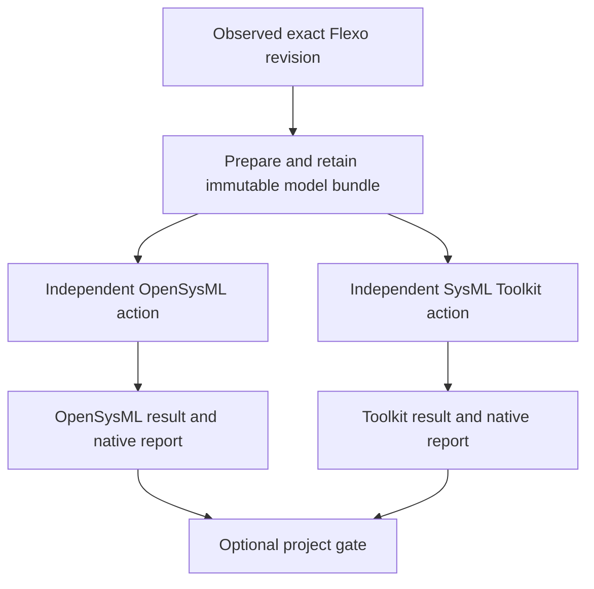

# Selectable SysML validation engines

Status: proposed implementation, 16 October 2026. This extends the initial alpha; the engine adapters, text-bundle acquisition and project gate are not implemented. Planning does not publish code, deploy a watcher or authorize transferring private model data. The first development model will be a new local synthetic multi-file model because no original textual source is currently available for an existing Flexo model.

## Outcome

A project selects OpenSysML, SysML Toolkit, both, and optionally SHACL. Each selected engine consumes the same immutable project source files and retains its own result. Reporting is the default; a separate explicit project policy determines whether required results pass a gate. GitHub is the first execution target. GitLab/Jenkins retain their existing generic trigger behavior.

## What must change in this codebase

The alpha is not already a general engine runner. [flexo.ts](../src-ts/flexo.ts) retrieves a pinned Turtle graph; [contracts.ts](../src-ts/contracts.ts) ties validation identity to a SHACL rule. [github-runner.ts](../src-ts/github-runner.ts) accepts an exact fixed set of snapshot/rule/report files, and [github-api.ts](../src-ts/github-api.ts) caps bundles at 4 MiB. These contracts need explicit extensions, rather than putting a different binary behind the current SHACL task.

Preserve observed event identity, source ownership, atomic event/action persistence, independent target progress and the existing feed schema. Extend the journal to retain prepared-input dependencies and engine actions. No compatibility/import framework is needed for this initial project. Frozen queued work and restart recovery remain requirements within the new implementation.

## Local spike checkpoint

The separately requested [local Flexo text-input spike](local-engine-input-spike.md) now demonstrates a producer-authored manifest binding, two revisions, retained original text after branch movement, and the existing adapter feed. Its RDF is a provenance index, not a semantic model conversion. The subsequent [CLI verification](engine-cli-verification-2026-10-16.md) demonstrates M0 on both captured bundles. Full M1 acceptance and production bundle acquisition remain open.

## 0. Pin and probe the engine profiles

Candidate versions identified from stable releases are OpenSysML `v0.10.1` and Toolkit `v0.10.2`. The [engine research](research-sysml-engines-2026-10-16.md) records their exact source identities, commands and findings. Their bounded local execution is recorded separately in the [CLI verification](engine-cli-verification-2026-10-16.md); broader capability acceptance remains open.

For Linux workers, retain the release/source identity, artifact SHA-256, executable version output, build provenance where available, bundled or external library digests and wrapper version. If a release has no suitable binary, choose a reviewed reproducible build pinned by source and toolchain; do not install an unpinned nightly.

Probe both engines with the local multi-file fixture before choosing the frozen command profile. Verify syntax and semantic stages, imports/library lookup, JSON schema, native exit behavior and location encoding. Check library/dialect compatibility explicitly. Identical project/dependency files do not imply that the engines' bundled standard libraries are interchangeable; record engine-specific standard-library profiles and any resulting coverage difference.

Toolkit diagnostics can classify unresolved references as warnings, so the initial semantic profile must make them fail explicitly. A zero exit status alone is not the result contract. Constraint/requirement execution is a later profile: native undecided outcomes must stay inconclusive.

**Exit gate:** checked-in or retained probe records identify both binaries, their libraries, supported requested checks, complete commands and observed outcomes on the same source bytes. A missing artifact or incompatible library profile remains an open decision.

## 1. Establish a revision-bound input bundle

Start with original text. The local fixture has at least two `.sysml` files, a cross-file import and a standard-library reference. Preserve file paths and bytes, entrypoints, project dependencies and their digests. Produce valid, syntax-error, unresolved-reference and missing-library variants without rewriting the valid fixture through either engine.

The current adapter has no original-text retrieval contract. Flexo upstream exposes repository artifacts, but the inspected routes do not make artifact enumeration a commit-specific source manifest. The presence of a text artifact is not proof that it belongs to the observed revision. Source inspected: [artifact routes](https://github.com/Open-MBEE/flexo-mms-layer1-service/blob/872e2da7fdd0250dd52c8ba44e2e3a52f6df8b0b/src/main/kotlin/org/openmbee/flexo/mms/routes/Artifacts.kt), [artifact reads](https://github.com/Open-MBEE/flexo-mms-layer1-service/blob/872e2da7fdd0250dd52c8ba44e2e3a52f6df8b0b/src/main/kotlin/org/openmbee/flexo/mms/routes/store/ArtifactStoreRead.kt). This is upstream source evidence, not a probe of a deployed Flexo version.

Choose one producer-owned binding for the local end-to-end test:

- A manifest referenced and hashed by the exact model revision, naming immutable source artifacts and paths; or
- An explicit provenance record binding that Flexo revision to an immutable Git tree/commit and manifest digest in a configured source repository.

Do not select the current Git branch, newest artifact, or an operator's current local directory as a substitute for the observed revision. A manually assembled text bundle can test engine invocation, but cannot satisfy revision-binding acceptance by itself. The ingest/producer must author the binding; the observer verifies it.

The content manifest records a format version, entrypoints and sorted file records `{path, role, sha256, size}`. A separate binding envelope records the Flexo source/revision, provenance and content-manifest digest. Create the content manifest before the Flexo commit and bind it in that revision; do not put the eventual commit ID inside a manifest whose hash that commit contains, which would be circular. Separate the shared project-input digest from each engine's standard-library/runtime identity. Retain both in every result. Reject escaping paths, duplicate entries, missing imports and hash mismatches. Materialize once, atomically, and reuse the retained bytes across engines and restarts.

If only RDF exists, stop and scope conversion separately. Retain the RDF snapshot, converter source/binary/settings, converted files, diagnostics and any source map. Neither engine supplies preprocessing to its competitor. Both engines' JSON inputs merit investigation, but RDF-to-API-JSON fidelity is not established and is not the initial route. Conversion failure or unproven fidelity cannot produce an original-source pass.

**Exit gate:** demonstrate a complete bundle, bound to an exact local Flexo revision with producer provenance, which both pinned engines consume. A concurrent branch move must not change any prepared file. Record any conversion or library limitations explicitly.

## 2. Add a small engine interface

Use reviewed, explicitly registered adapters `opensysml` and `sysml-toolkit`. Keep engine selection separate from CI destination selection. Configuration contains engine/profile IDs and reviewed settings, not arbitrary shell commands.

The engine module exposes two operations: describe the supported pinned profile, and execute an immutable bundle under a bounded execution context to return an engine result. Each adapter owns argument construction, working directory/library lookup, native output decoding and capability declaration. A shared process runner owns deadlines, process-group termination, output limits and exit/signal capture. Use argument arrays, a read-only input directory and offline model/library access. No persistent engine service or watcher-side engine execution is required.

Suggested responsibilities, not mandatory one-file wrappers:

| Module                        | Responsibility                                                             |
| ----------------------------- | -------------------------------------------------------------------------- |
| Model input                   | Resolve revision provenance; materialize and verify one immutable bundle   |
| Engine registry and adapters  | Select a pinned engine/profile; invoke it and decode native output         |
| Process execution             | Enforce reviewed limits and retain native stdout/stderr/exit evidence      |
| Engine result contract        | Validate revision/input/runtime/check bindings and normalized diagnostics  |
| GitHub engine worker/delivery | Retain inputs, claim work, execute selected adapter and reconcile evidence |
| Optional gate                 | Evaluate required result identities and explicit policy                    |

**Exit gate:** malformed input creates findings; missing binaries, invalid native output, unsupported profiles, signals and timeouts remain non-passing outcomes. Keep SHACL's existing task separate and optional.

## 3. Retain a result that preserves engine differences

Use a versioned engine request/result rather than making SHACL-specific fields pretend to be engine-neutral. Retain:

- Exact source revision, input preparation/bundle digest, entrypoints and producer/conversion provenance.
- Engine ID, version, binary digest, wrapper/worker identity, library identities and frozen settings/resource limits.
- Requested checks and a separate per-check completion/outcome record.
- Execution state `completed | error | timeout | unsupported`, plus verdict `pass | fail | inconclusive`.
- Native exit code or signal, normalized diagnostics, original stdout/stderr and their digests, truncation state, report identity and execution timestamps.

Pass requires successful execution and explicit completion of every requested check with no policy-failing findings. Partial completion cannot pass: retain a conclusive failing model finding when available, otherwise use inconclusive or an execution error. Malformed/missing reports, unknown native status, missing dependencies or truncated decisive output cannot establish pass. A parser rejection is a finding, not an infrastructure crash. If later semantic analysis cannot run after a syntax error, record that stage as not completed, with its reason.

Normalize severity, relative path and location for display, keeping native severity/code and coordinates. Record position encoding; test Unicode and line endings before converting offsets. Converted-input diagnostics identify converted files unless a verified source map exists. Do not infer equivalent diagnostic codes across engines or invent a native code when none is provided.

A wrapper may identify a completed native syntax/semantic stage from its verified command profile and report contract; it must not invent per-rule execution coverage that the engine does not emit. OpenSysML strict mode addresses unsupported extensions, whereas Toolkit strict mode also promotes warnings: retain separate warning policy rather than treating the flags as equivalent.

**Exit gate:** fixtures distinguish model findings from process/report failures, and every report verifies all immutable request bindings before completing an action.

## 4. Run independent durable actions on GitHub

Configuration selects one or two separate `engine-validation` actions. Proposed selectors are engine ID, pinned profile, requested checks and target; they are not accepted by the current alpha parser. A `both` choice expands into two actions, not one opaque combined command.

Prepare one shared project-input object. Input preparation has its own retained pending/ready/error status; engine actions depend on that object. An input failure remains visible and does not masquerade as two successful engine runs. A valid shared bundle allows either engine to finish even when the other crashes.

Keep three identities distinct:

| Identity           | Binding                                                                           |
| ------------------ | --------------------------------------------------------------------------------- |
| Input preparation  | Source/revision plus frozen provider and project-dependency settings              |
| Engine computation | Revision, bundle, engine binary/wrapper, libraries, settings and requested checks |
| Action/delivery    | Observed event, selected action and frozen execution destination                  |

Changing an engine/version/library/profile changes work identity. Removing an action cannot retarget queued work. Separate worker claims/results protect each engine computation; reuse the reviewed GitHub claim/reconciliation semantics, including the existing refusal to rerun a claimed crashed worker automatically. No general exactly-once guarantee is added.

Introduce a versioned file manifest for engine input/result records; keep SHACL's current strict file lists intact until explicitly refactored and verified. Measure bundle sizes against the existing 4 MiB limit before choosing retention limits. Do not silently raise limits or move inputs to expiring workflow artifacts. Private input/result retention remains the initial target behavior.

**Exit gate:** either engine can be selected, both can share one bundle, failures are isolated, accepted-but-lost dispatches reconcile, duplicates do not rerun claimed work, and queued jobs retain the original revision after branch/configuration changes.

## 5. Add project gating after independent reporting works

Default `report-only`; selectable policies are `require-opensysml`, `require-toolkit`, and `require-both`. Bind a gate to the event/revision, shared input bundle, policy digest and exact required action identities. Results from another revision/profile cannot satisfy it.

All required actions must explicitly pass for a passing gate. A required failed verdict fails the gate; a missing/running/unsupported/timeout/error/inconclusive required result blocks it. Optional engine results remain visible without changing a gate that does not require them. Show disagreements without averaging, majority voting or labeling either engine defective. A passing gate establishes only the configured checks and versions.

## Acceptance sequence and scope

| Milestone                            | Concrete demonstration                                                                                                           |
| ------------------------------------ | -------------------------------------------------------------------------------------------------------------------------------- |
| M0: pinned CLI probes                | Both engines consume one local multi-file text fixture; native outputs and capabilities recorded                                 |
| M1: revision-bound local input       | Local model producer binds a complete source manifest to an exact Flexo revision; branch movement cannot change captured bytes   |
| M2: first engine action              | OpenSysML syntax/semantic request, durable GitHub claim and retained result work end to end                                      |
| M3: independent second engine        | Toolkit runs on identical project files with separate identity/result; either or both selectable                                 |
| M4: reporting and gate               | Differences remain visible and every required inconclusive/missing outcome blocks pass                                           |
| Later: capability-specific execution | Selected constraint/requirement checks with explicit undecided/unsupported semantics and pinned solver/settings where applicable |

The acceptance set includes valid multi-file input, syntax error, unresolved reference/type error, missing libraries, unsupported check, malformed report, timeout/crash, changed source while queued, restart/lost-response recovery, changed engine configuration, and disagreement. Add altered bundle/result bindings and Unicode positions because they protect the input/result contract. Initially use controlled transports and local processes; GitHub live acceptance is a separately bounded run on a designated private target with synthetic model data.

No engine installation, Flexo mutation or GitHub submission follows merely from this plan. The separately requested local setup is a development spike, not implementation or deployment of engine adapters. Do not change GitLab/Jenkins beyond their current generic triggers in this scope.

The subsequent [local CLI verification](engine-cli-verification-2026-10-16.md) demonstrates both engines on the two revision-bound text bundles and records negative probes. Durable engine actions remain planned.
